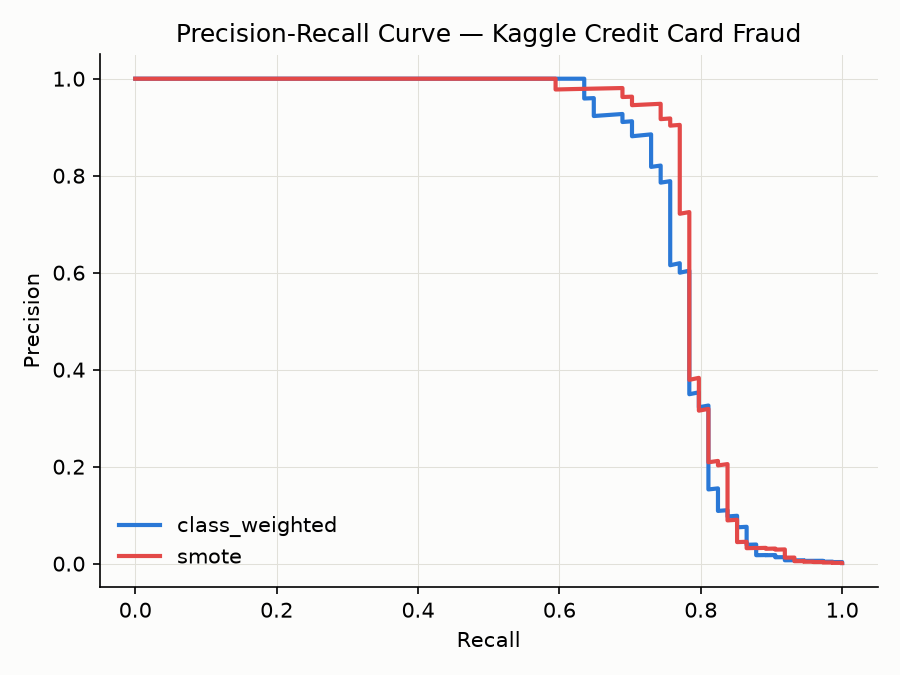
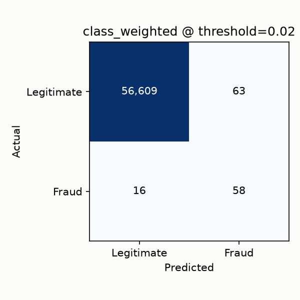
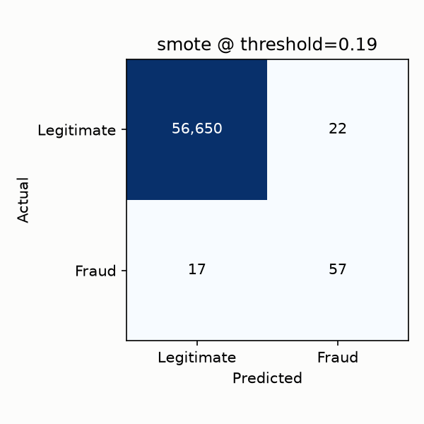
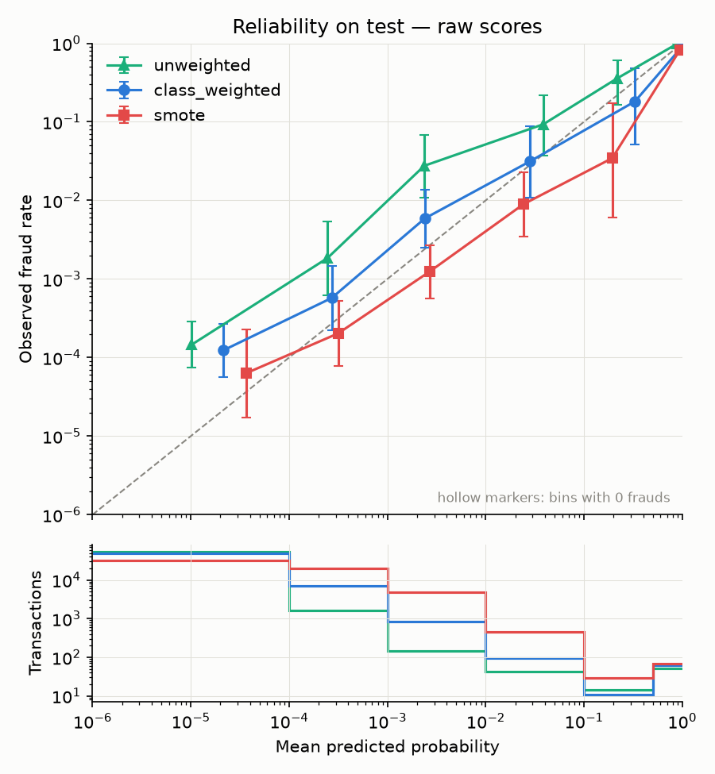
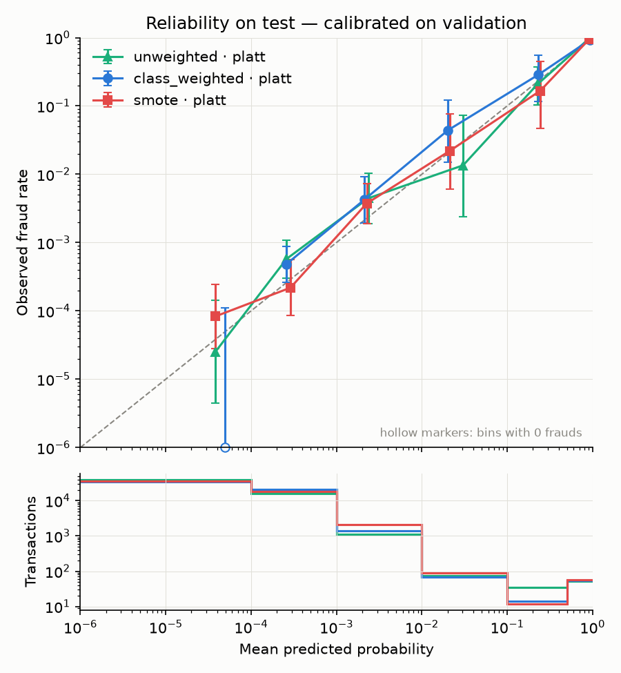

# Credit Card Fraud Detection System

[](https://github.com/liamhavers/fraud-detection-system/actions/workflows/ci.yml)

End-to-end fraud detection: raw transaction data → an imbalance-aware trained model → a served prediction API → basic production monitoring — plus a second, richer dataset for feature-engineering depth and a statistically rigorous offline A/B test.

Built as a portfolio project demonstrating end-to-end, production-minded ML engineering for tech/finance Data Scientist roles.

**Live demo**: [fraud-detection-api-u874.onrender.com/docs](https://fraud-detection-api-u874.onrender.com/docs) — interactive Swagger UI, try `/predict` directly. Hosted on Render's free tier, so it spins down after 15 minutes idle; the first request after a while may take 30–60 seconds to cold-start (see [Deploy to Render](#deploy-to-render-optional) for how this is set up).

**Follow-on project**: [fraudDetection_databricks](https://github.com/liamhavers/fraudDetection_databricks) rebuilds the IEEE-CIS side of this work as a Spark pipeline on Databricks, with Delta Lake tables, past-only velocity features, MLflow model tracking with champion and challenger aliases, batch scoring and weekly PSI drift, run as one scheduled Databricks Job.

## Problem Statement

> The real job isn't maximising accuracy — it's finding the operating point that minimises the *combined expected cost* of missed fraud and false alarms.

Card issuers lose money two ways: missed fraud (direct loss, chargebacks, reputational damage) and false alarms (blocked legitimate transactions, customer churn, manual review cost). With fraud typically well under 1% of transactions, a model that predicts "not fraud" every time is 99%+ "accurate" and useless — accuracy as a headline metric would be actively misleading here. That cost trade-off, made explicit, is the core deliverable of this project.

## Phase 0 Decisions (locked)

These decisions were made deliberately up front, to keep the project focused rather than open-ended.

- **Two datasets, two different jobs**: Most fraud-detection portfolio projects stop at the Kaggle Credit Card Fraud dataset — it's clean, fast to work with, and consequently used in hundreds of near-identical repos. It's kept here as the dataset behind the **served model**, because its small anonymised feature set is realistic for a low-latency `/predict` endpoint. Alongside it, this project also uses **IEEE-CIS Fraud Detection** — raw, non-anonymised transaction and identity fields — as a **modelling-depth showcase**: real categorical encoding, joins, and missing-data strategy, rather than fitting a model to precomputed PCA components. IEEE-CIS isn't wired into the live API (see [Architecture](#architecture) for why); it's evaluated and written up on its own.
- **Time-aware train/test split**: Both datasets' time columns (`Time` for Kaggle, `TransactionDT` for IEEE-CIS) are used to split chronologically rather than shuffle randomly — training data precedes test data. This mirrors production, where a model only ever sees past transactions at training time; a random split would leak future distribution information into training and overstate performance. Since [Phase 7](#phase-7--validation-split--probability-calibration-complete), the Kaggle split is three-way (60% train / 20% validation / 20% test, in time order): every choice is made on validation, and test is only used to report.
- **PR-AUC over accuracy/ROC-AUC**: With ~0.17% positive class in the Kaggle data, accuracy is meaningless and ROC-AUC can look deceptively good due to the large true-negative volume. PR-AUC is reported as the headline metric for both datasets.
- **Cost-sensitive threshold selection over a default 0.5 cutoff**: An operating threshold is chosen to minimise *expected cost* using illustrative unit costs (false negative = £100 average fraud loss, false positive = £5 customer friction / manual investigation cost — see `src/config.py`), rather than defaulting to a 0.5 probability cutoff. Because a missed fraud costs 20x more than a false alarm, the model should flag far more readily than a 0.5 cutoff would. Once the model's scores are calibrated probabilities ([Phase 7](#phase-7--validation-split--probability-calibration-complete)), the cost-optimal threshold follows directly from the costs: flag when p > £5 / (£5 + £100) ≈ 0.048. See [Phase 3](#phase-3--evaluation--shadow-mode-ab-testing-complete) for the cost numbers.
- **Shadow-mode A/B test, not a live experiment**: I wanted hands-on practice with the *statistics* behind A/B testing — confidence intervals, hypothesis testing, effect size — which I hadn't built before. A live, traffic-splitting production experiment isn't achievable in a portfolio project with no real users, so this project instead replays historical held-out data through two competing modelling policies (SMOTE-resampling vs. class-weighting) and statistically compares their outcomes offline (a paired bootstrapped confidence interval on the expected-cost difference, rather than just picking whichever number is bigger). **I'm explicit that this is a simulation, not production A/B-testing experience**: it has no real traffic split, no protection against novelty or seasonality effects, and none of the online-experimentation infrastructure a live test would need. It's deliberate practice of the underlying statistical reasoning, done honestly rather than dressed up as something it isn't.
- **IEEE-CIS kept out of the served API**: Its raw schema is 400+ columns across two joined files — an unwieldy Pydantic request schema that would hurt the "Swagger docs as the interface" goal more than it would help. It's evaluated and written up as its own modelling exercise instead.

## Goals

- Build an end-to-end pipeline from raw transaction data to a served, monitored prediction API
- Handle severe class imbalance two ways (SMOTE vs. class-weighting) and pick a winner with statistical evidence, not intuition
- Select an operating threshold via explicit cost-sensitive reasoning, not a default cutoff
- Make the model's scores real, calibrated probabilities, and keep the test set out of every choice
- Add a second, richer dataset to demonstrate real feature-engineering practice beyond anonymised PCA components
- Practice the statistics behind A/B testing through an honest, clearly-scoped offline shadow-mode simulation
- Ship basic production monitoring (structured logging + drift detection) so "monitoring" is a real claim, not just a README line
- Document every decision and trade-off as clearly as the code itself

## Architecture

```
                          ┌──────────────────┐
     Kaggle dataset   →   │  src/data/        │  load, clean, time-aware split
     (served model)       │  preprocess.py    │
                          └────────┬──────────┘
                                   │
     IEEE-CIS dataset  →  ┌────────▼──────────┐
     (showcase only,      │  src/data/         │  join, categorical encoding,
      not served)         │  preprocess_ieee.py│  missing-data strategy
                          └────────┬──────────┘
                                   │
                          ┌────────▼──────────┐
                          │  src/models/       │  SMOTE vs class-weighting,
                          │  train.py          │  XGBoost fit (both datasets)
                          └────────┬──────────┘
                                   │
                    ┌──────────────┼───────────────────┐
                    │              │                    │
          ┌─────────▼────────┐   ┌▼───────────────────┐│
          │  src/models/      │   │  src/models/        ││
          │  evaluate.py      │   │  ab_test.py          ││
          │  PR-AUC, cost-    │   │  shadow-mode         ││
          │  sensitive        │   │  statistical compare ││
          │  threshold        │   │  (bootstrap CI)      ││
          └─────────┬────────┘   └─────────────────────┘│
                    │  unweighted model + Platt (served)  │
          ┌─────────▼────────┐                            │
          │  src/models/      │                            │
          │  predict.py       │                            │
          └─────────┬────────┘                            │
                    │                                      │
          ┌─────────▼────────┐        ┌──────────────────┐│
Client →  │  api/main.py       │  ────▶ │  src/monitoring/  ││
POST      │  FastAPI (Docker)  │  logs  │  drift.py (PSI)   ││
/predict  └───────────────────┘        └──────────────────┘│
                                                             │
IEEE-CIS results reported in README/notebook only ──────────┘
```

## Repo Structure

```
fraud-detection-system/
├── data/
│   ├── raw/
│   │   ├── creditcard/     # gitignored — Kaggle Credit Card Fraud CSV
│   │   └── ieee_cis/       # gitignored — IEEE-CIS transaction + identity CSVs
│   └── processed/          # gitignored
├── notebooks/
│   ├── 01_eda_creditcard.ipynb
│   ├── 02_eda_ieee_cis.ipynb
│   └── 03_calibration.ipynb  # Phase 7 walk-through
├── src/
│   ├── data/                 # load, preprocess (Kaggle), preprocess_ieee (IEEE-CIS)
│   ├── models/                # train, evaluate, calibrate, calibration_report, ab_test, predict
│   ├── monitoring/            # drift.py
│   ├── pandas_reference/      # original pandas pipeline, kept for comparison (not used by training/API)
│   └── config.py             # paths, thresholds, hyperparameters
├── api/                # FastAPI app + Pydantic schemas (Kaggle model only)
├── models/              # gitignored model artifacts
├── tests/                # test_preprocess, test_preprocess_ieee, test_train, test_evaluate, test_calibrate, test_ab_test, test_predict, test_drift, test_api; pandas_reference/ for the pandas pipeline
├── experiments/          # logged run metrics (json/csv)
├── reports/              # PR curve, confusion matrix and reliability diagram plots (committed, for the README)
├── benchmarks/           # pandas vs. polars parity check + timings
├── sample_transaction.json  # example /predict request body
├── requirements.txt       # full dev/training environment
├── requirements-api.txt   # lean runtime deps for the Docker image only
├── Dockerfile
└── docker-compose.yml
```

## Project Plan

### Phase 0 — Scaffolding
- [x] Repo structure, `config.py` as single source of truth for paths/thresholds/hyperparameters
- [x] FastAPI skeleton (`/health` working, `/predict` schema-validated, inference pending trained model)
- [x] Test scaffolding (`pytest`, API + preprocessing tests)
- [x] Dockerfile / docker-compose
- [x] CI workflow (lint + test on push)

### Phase 1 — Data & EDA (complete)
- [x] Kaggle EDA notebook (class imbalance, feature distributions, correlation with target, leakage checks) — 284,807 rows, 1,081 exact duplicates dropped by `clean()`. A weak baseline using *only* `Time`+`Amount` scores ROC-AUC 0.58, confirming the real fraud signal lives in the PCA components, not superficial fields. The leakage check surfaced something worth being honest about rather than hiding: 12,446 rows across the full dataset share an identical feature fingerprint (V1–V28 + Amount) with another row under a different `Time` — but **every one of them is a legitimate transaction, zero are fraud**. Given the anonymised features make the root cause unconfirmable and it can't inflate the metric that matters here, this is documented as a known data-quality caveat rather than papered over with a guessed fix.
- [x] IEEE-CIS EDA notebook (categorical cardinality, missing-data patterns, engineered features) — 590,540 transactions, 3.5% fraud (~20x less imbalanced than Kaggle), only 24.4% with a matching identity record. Fraud rate differs sharply by that alone (7.8% with an identity match vs. 2.1% without), which is why `has_identity` is engineered as an explicit feature. 174/394 columns are >50% null; missingness is left as native `NaN` for XGBoost (no imputation) with explicit `_is_missing` flags added for the most-null columns, since for this dataset absence often reflects *how* a transaction was made, not noise.
- [x] Data loading, cleaning, time-aware train/test split (both datasets)
- [x] IEEE-CIS feature engineering (`preprocess_ieee.py`) — join, categorical encoding, card-level aggregations (`card1_frequency`, `card1_mean_amount`, `time_since_last_txn_same_card`). Encoders and stats are fit on the training split only and applied to test — fitting on the whole joined dataset before splitting would leak exactly the kind of cross-split information the Kaggle notebook's finding was a reminder to watch for.

### Phase 2 — Modelling (complete)
- [x] Baseline logistic regression + XGBoost training on Kaggle, SMOTE vs. class-weighting comparison. Models are trained on the first 60% of the data (time-ordered) and compared on the next 20% (validation); test PR-AUC is reported once, in the [Phase 7](#phase-7--validation-split--probability-calibration-complete) calibration report. An unweighted XGBoost (no SMOTE, no class weights) was added in Phase 7 as a calibration control.

  | Model | PR-AUC, validation (57 frauds) | PR-AUC, test (74 frauds) |
  |---|---|---|
  | Logistic regression (class-weighted), baseline | 0.773 | — |
  | XGBoost, unweighted | 0.782 | 0.796 |
  | XGBoost + class-weighting | 0.781 | 0.777 |
  | XGBoost + SMOTE | 0.758 | 0.792 |

  With 57 and 74 frauds these differences are within noise: SMOTE is last on validation and second on test. All XGBoost variants are kept as saved artifacts (`model_unweighted.pkl`, `model_class_weighted.pkl`, `model_smote.pkl`) rather than discarding the "losers", and the choice between them is tested statistically in the Phase 3 shadow-mode A/B test. *(Original Phase 2 figures, from an 80/20 split with models compared on test: logistic regression 0.761, SMOTE 0.789, class-weighting 0.798. They changed because training data shrank from 80% to 60%, and comparing on test was itself a form of selection on test; see Phase 7.)*
- [x] IEEE-CIS XGBoost training on the engineered feature set — PR-AUC 0.497 against a 3.5% base fraud rate. While building this, found and fixed a real gap in `preprocess_ieee.py`: 17 identity/device columns (`id_12`–`id_38`, `DeviceType`, `DeviceInfo`) were never added to the categorical-encoding list from Phase 1, so they were still raw strings and would have failed at `fit()`. Fixed by extending the same fit-on-train-only label-encoding path already used for `ProductCD`/`card4`/etc., guarded to only touch columns actually present (so the synthetic-data unit tests still pass without needing every identity column).
- [x] Simple experiment tracking — each training run logs hyperparameters + PR-AUC per model to a timestamped JSON file under `experiments/`

### Phase 3 — Evaluation & Shadow-Mode A/B Testing (complete)
- [x] PR-AUC, precision-recall curve, confusion matrix at candidate thresholds, cost-sensitive threshold selection (Kaggle). Each threshold is searched on the validation slice, then evaluated on the held-out, time-ordered test set (56,746 transactions, 74 fraud):

  | Policy | PR-AUC | Threshold | Confusion matrix (TP / FP / TN / FN) | Expected cost | Cost reduction vs. naive baseline |
  |---|---|---|---|---|---|
  | XGBoost + class-weighting (raw scores) | 0.777 | 0.02 (searched on validation) | 58 / 63 / 56,609 / 16 | £1,915 | 74.1% |
  | XGBoost + SMOTE (raw scores) | 0.792 | 0.19 (searched on validation) | 57 / 22 / 56,650 / 17 | £1,810 | 75.5% |
  | XGBoost unweighted + Platt calibration | 0.796 | 0.048 (analytic, no search) | 59 / 45 / 56,627 / 15 | £1,725 | 76.7% |

  The naive baseline ("never flag a transaction") costs £7,400 (74 missed frauds × £100). Every policy cuts expected cost by roughly three-quarters, and the gaps between them are a few frauds wide (see the A/B test below). Picking 0.5 by default would have been a meaningfully worse decision than any of these thresholds. *(Original Phase 3 figures: thresholds 0.29 for class-weighting and 0.88 for SMOTE, costs £1,695 and £1,760, with each threshold searched and evaluated on the same test set. That was optimistic. [Phase 7](#phase-7--validation-split--probability-calibration-complete) moved the search to validation and showed that raw-score thresholds like these move a lot between training runs, which is the case for calibrating.)*

  <p align="center">
    <br>
    
    
  </p>
- [x] IEEE-CIS PR-AUC (0.497 against a 3.5% base fraud rate) reported in [Phase 2](#phase-2--modelling-complete) — no separate threshold/A-B exercise here since this dataset isn't served live (see [Phase 0 Decisions](#phase-0-decisions-locked))
- [x] Bootstrap confidence interval logic (`ab_test.py`)
- [x] Shadow-mode A/B test full writeup (SMOTE vs. class-weighting). Both policies' validation-chosen thresholds are replayed over the held-out test set, and per-transaction expected cost is compared with a 10,000-resample **paired** percentile bootstrap. Because both policies score the *same* transactions, the bootstrap resamples transactions and differences the two costs within each one, so only the transactions where the policies disagree add noise. Mean cost per transaction was 0.0319 for SMOTE vs. 0.0337 for class-weighting (SMOTE 5.5% cheaper). The policies disagree on only 54 of 56,746 transactions, and the 95% paired CI on the difference is **[−0.0046, +0.0025]. It spans zero, so the difference is *not* statistically distinguishable from noise** at this sample size (74 frauds in test). **Read honestly: this is an inconclusive result, not a null one.** With so few positive-class examples the test has limited power to detect an effect this small. As a rough guide, detecting a 10% cost difference with 80% power would need about 7× this test set (~500 frauds), and halving the effect quadruples that. That sample-size intuition is what this exercise was built to develop. Class-weighting was originally kept as the served policy on simplicity grounds (no resampling step), not because the A/B test proved it superior; in a live setting the honest next step would be "keep collecting data, or treat this as a tie." Since Phase 7 the API serves a calibrated model instead (see Phase 4). A second comparison, calibrated vs. raw, is in [Phase 7](#phase-7--validation-split--probability-calibration-complete). See [Phase 0 Decisions](#phase-0-decisions-locked) for what this simulation does and doesn't demonstrate versus a real online experiment. *(Original Phase 3 result: class-weighting 0.0299 vs. SMOTE 0.0310 per transaction, 95% CI [−0.0185, 0.0208], with thresholds searched on test and an **unpaired** bootstrap that resampled the two policies' costs independently. Phase 7 fixed both; the unpaired interval was 3–6× wider than the paired one on the same data.)*

### Phase 4 — Productionisation (complete)
- [x] Wire up `/predict` inference with the trained Kaggle model — `FraudPredictor` (`src/models/predict.py`) loads the model and its calibrator once at API startup (via FastAPI's `lifespan`, so a missing artifact fails fast rather than on someone's first request), remaps the request's lowercase `time`/`v1`..`v28`/`amount` fields into the exact column names/order the model was trained on, and returns `fraud_probability`, `flagged`, and the threshold applied. Since Phase 7 the served artifacts are the unweighted XGBoost model plus the Platt calibrator fitted to it on the validation slice, published together as the [`model-v2` release](https://github.com/liamhavers/fraud-detection-system/releases/tag/model-v2). So `fraud_probability` is a calibrated probability, and `flagged` uses the threshold that follows from the costs, `DECISION_THRESHOLD` = £5 / (£5 + £100) ≈ 0.048, rather than one found by search. Verified end-to-end against a real legitimate transaction (`sample_transaction.json`: probability 0.00004, not flagged) and a real fraud transaction from the test slice (probability 0.966, flagged). *(Until Phase 7 the API served the raw class-weighted model, [`model-v1`](https://github.com/liamhavers/fraud-detection-system/releases/tag/model-v1), at a threshold of 0.29 searched on test; its "probabilities" were inflated scores.)* Every request is logged with a timestamp, input summary, and output (`api/main.py`).
- [x] `drift.py` — PSI (Population Stability Index) per feature, quantile-binned on the reference window. Two real checks run via `python -m src.monitoring.drift`: (1) train vs. test windows on the actual Kaggle split — `Time` shows enormous PSI (8.3), but that's a structural artifact of a chronological split (test is definitionally "later," not "drifted"), not a meaningful alarm; more interestingly, five PCA features (`V1`, `V3`, `V28`, `V11`, `V25`) show real, if modest, distribution shift across the same time boundary — a genuine finding, left visible rather than tuned away. (2) A synthetic "new window" with `Amount` inflated 3x — PSI on `Amount` correctly jumps from 0.01 (stable) to 4.7 (flagged), confirming the check actually catches injected drift and isn't just reporting noise.
- [x] Docker — rebuilt with a dedicated `requirements-api.txt` (fastapi/pandas/xgboost/scikit-learn/joblib only) rather than the full dev `requirements.txt`, cutting the image from 2.29GB to 1.82GB by dropping Jupyter/Kaggle/matplotlib/seaborn, none of which the served API touches. `xgboost` is pinned exactly (`==3.3.0`, matching the training environment) in both requirements files — a loose `>=` constraint let the container resolve a different xgboost version than what pickled the model artifact, which is a real (if often silent) compatibility risk for any pickle-based deployment. `docker build && docker run` and `docker compose up` both verified working end-to-end against a real trained model.

### Phase 5 — Polish & Packaging
- [x] Full results write-up in this README (PR-AUC, chosen threshold, expected cost reduction, both datasets) — written incrementally as each phase landed (see [Phase 2](#phase-2--modelling-complete) and [Phase 3](#phase-3--evaluation--shadow-mode-ab-testing-complete)) rather than backfilled at the end, so the numbers stayed attached to the reasoning behind them
- [x] Stretch: deploy on Render/Railway free tier and link a live demo URL — live at [fraud-detection-api-u874.onrender.com/docs](https://fraud-detection-api-u874.onrender.com/docs). Built from a fresh GitHub clone with no local artifacts present, confirming the [published-release fallback](https://github.com/liamhavers/fraud-detection-system/releases/tag/model-v1) in the Dockerfile actually works end-to-end, not just in local simulation — verified by hitting `/predict` against the live service with the same `sample_transaction.json` payload used everywhere else in this README and getting the identical probability (0.0001395379804307595) back. Re-verified the same way after Phase 7 switched the service to the calibrated `model-v2` pair: the live service returns 0.00003658957338868171 for `sample_transaction.json` (not flagged) and 0.966 for a real test-slice fraud (flagged), with `threshold_applied` 0.0476, identical to local uvicorn and to a Docker build from an empty `models/` dir.

### Phase 6 — Polars Port (complete)
- [x] Preprocessing and feature engineering for both datasets (`preprocess.py`, `preprocess_ieee.py`) rewritten as polars LazyFrame transforms: every step from `scan_csv` to the time-aware split to the IEEE-CIS encoders is one lazy query plan, collected only where the data crosses into scikit-learn/XGBoost (`train.py`) or where a fitted value genuinely has to exist first (the category vocabularies and missingness flags decide the output schema, so `fit_feature_encoders` is the one function that executes a query — and it collects its four aggregations together in a single pass).
- [x] PSI in `drift.py` rebuilt from polars expressions: one query computes every feature's quantile bin edges, one query per window computes every feature's bin shares, and the PSI sum is an aggregation expression grouped by feature — no per-column numpy loop.
- [x] Time-ordered split kept identical: same `int(n × (1 − test_size))` boundary, now with an explicitly stable sort. The pandas version used `sort_values`' default quicksort, which isn't stable; it only produced a deterministic split because both raw files happen to be pre-sorted by time. The polars version guarantees tied timestamps keep file order (and a test pins that down).
- [x] The original pandas implementation is kept, unchanged, in [`src/pandas_reference/`](src/pandas_reference/) — same module and function names as the polars version (`load`, `preprocess`, `preprocess_ieee`, `drift`) so the two read side by side, with its original tests still running in CI under `tests/pandas_reference/`. It isn't used by training or the API; it's the baseline the port is checked and timed against.
- [x] **Parity verified on the real data** (`python -m benchmarks.compare_pandas_polars parity`, polars vs. `src/pandas_reference/`): Kaggle train/test splits identical row-for-row; all 30 PSI values within 1e-15 and identical drift flags; IEEE-CIS category vocabularies/codes and card1 stats identical; both 446-column IEEE-CIS feature frames identical in row order, column order and values (max float difference 2e-13, from summation order in the grouped mean). As an end-to-end check, retraining on polars-produced features gives **bit-identical** XGBoost predictions for all three XGBoost models (Kaggle class-weighted, Kaggle SMOTE, IEEE-CIS), and a logistic-regression baseline within 4e-13 (one-ULP CSV-parser differences) — every reported PR-AUC above is unchanged.
- [x] Three things the parity check surfaced, all kept visible rather than smoothed over:
  1. **One engineered column is named differently, with identical values.** The pandas pipeline picked its 8 missing-indicator columns with an unstable sort over null fractions, and `id_22`, `id_23` and `id_27` tie exactly (0.990955 — these identity fields go missing together). pandas happened to pick `id_27`; which one it picks depends on numpy's sort internals, not the data. The polars version breaks ties by column order (`id_22`). The two indicator columns are value-identical and sit in the same position, so the feature matrix is unchanged; only the name differs.
  2. **The Kaggle CSV changes number format mid-file.** `Time` is written as plain integers until row 153,760, then switches to `1e+05`. pandas silently read the whole column as float; polars' sampled schema inference would type it as an integer and then fail on that row, so the loader pins `Time` to Float64.
  3. **A stale notebook output.** Re-running `02_eda_ieee_cis.ipynb` showed its categorical-cardinality chart had last been rendered before the Phase 2 fix that extended the categorical column list from 14 to 31 fields — it's now current.

**Timings** — `python -m benchmarks.compare_pandas_polars timing`: each stage runs in its own process, one warm-up then the median of 5 timed runs, on an 8-core AMD Ryzen 7 5700X3D under WSL2 (12GB RAM cap), Python 3.12, pandas 3.0.3, polars 1.44.2. Raw CSVs are in the OS page cache after warm-up, so these measure compute, not cold disk reads.

| Stage | pandas (median) | polars (median) | Speedup |
|---|---:|---:|---:|
| Kaggle: read CSV → clean → time-aware split | 1.71s | 0.19s | 9.0× |
| IEEE-CIS: read CSVs → join → split → feature engineering | 15.59s | 3.15s | 4.9× |
| IEEE-CIS: join → split → feature engineering (CSVs pre-loaded) | 3.94s | 0.81s | 4.9× |
| PSI drift report, 30 Kaggle features (train vs. test) | 0.25s | 0.07s | 3.7× |

Most of the end-to-end gain is CSV parsing, which polars multi-threads and pandas' C parser doesn't: in the IEEE-CIS pipeline, reading the two CSVs (~710MB) was ~75% of pandas' time. The in-memory row isolates the transforms themselves (join, sort, encoders, per-card window features), which are also ~5× faster. In absolute terms these are seconds on a dataset that fits in RAM — the practical win here is a faster iteration loop, not a pipeline that was previously infeasible. pandas is still used where it's the lingua franca: at the scikit-learn/XGBoost boundary, in the API's single-row inference path, and for plotting in the EDA notebooks.

### Phase 7 — Validation Split & Probability Calibration (complete)

A review of the finished project found two weaknesses. Both matter most for credit-risk work, where a model's probabilities feed pricing and expected loss directly.

**What was wrong**

1. **The test set was used for selection.** The cost-minimising threshold was searched on test and the cost then reported on the same test set, and SMOTE vs. class-weighting was compared on test PR-AUC. The PR-AUC values were fair estimates; the threshold, the cost and the model choice were optimistic.
2. **The served scores weren't probabilities.** Class-weighting (positives weighted ~500:1) and SMOTE (resampled to 50/50) both train the model on a much higher fraud rate than the real ~0.1–0.2%. A score of 0.29 didn't mean a 29% chance of fraud, so the threshold had to be found by search instead of following from the costs.

**What changed**

- **Three-way time-ordered split** (`time_aware_train_val_test_split`): 60% train / 20% validation / 20% test. Validation is carved from the end of the old training data, so the test slice is row-for-row identical to the old one and old and new test numbers are directly comparable.

  | Slice | Transactions | Frauds | Fraud rate | Window |
  |---|---|---|---|---|
  | Train | 170,235 | 342 | 0.20% | hours 0–33 |
  | Validation | 56,745 | 57 | 0.10% | hours 33–40 |
  | Test | 56,746 | 74 | 0.13% | hours 40–48 |

- **All models trained on train only, compared on validation.** Test is touched once, for final reporting, in `python -m src.models.calibration_report`.
- **No refit after selection.** Teams often refit the chosen model on train + validation to use the most recent data. That would leave the calibrator (fitted on validation scores from the *un*-refitted model) mismatched to the model it corrects, with no held-out data left to recalibrate on. Here the models stay trained on the 60% only, at the cost of ~57k fewer recent training rows.
- **Calibration** (`src/models/calibrate.py`), fitted on validation only:
  - *Platt scaling*, implemented directly so its two parameters are visible: `logit(p_cal) = a · score + b`, an unpenalised logistic regression on XGBoost's raw log-odds.
  - *Isotonic regression*, a non-decreasing step function.
  - Platt vs. isotonic is chosen per model by 5-fold cross-validated log loss *within* validation, since scoring a calibrator on the rows it was fitted on always favours the more flexible one. Platt won for all three models.
- **Calibration metrics**: Brier score and Brier skill score, log loss, observed/expected ratio (O/E), calibration slope and intercept, and reliability tables with Wilson score intervals on log-spaced bins (a 0.1% base rate puts nearly every fraud in one bin under equal-width bins). Each function is tested on synthetic data with a known answer; for example, Platt recovers a known odds inflation and the calibration slope recovers a known overconfidence.
- **The A/B test** now chooses thresholds on validation and uses a paired bootstrap (see [Phase 3](#phase-3--evaluation--shadow-mode-ab-testing-complete)).

**Results on test**

| Model | Calibration | PR-AUC | Brier skill | Log loss | O/E | Calibration slope |
|---|---|---|---|---|---|---|
| Unweighted | raw | 0.796 | 0.679 | 0.00301 | 1.45 | 0.86 |
| Unweighted | Platt | 0.796 | 0.693 | 0.00255 | 1.12 | 0.99 |
| Unweighted | isotonic | 0.760 | 0.691 | 0.00352 | 1.13 | 0.27 |
| Class-weighted | raw | 0.777 | 0.640 | 0.00303 | 1.04 | 0.70 |
| Class-weighted | Platt | 0.777 | 0.667 | 0.00276 | 1.12 | 0.99 |
| Class-weighted | isotonic | 0.747 | 0.670 | 0.00282 | 1.13 | 0.94 |
| SMOTE | raw | 0.792 | 0.651 | 0.00293 | 0.72 | 0.81 |
| SMOTE | Platt | 0.792 | 0.713 | 0.00257 | 1.07 | 1.00 |
| SMOTE | isotonic | 0.762 | 0.708 | 0.00360 | 1.06 | 0.71 |

O/E is observed / expected frauds: 1 means right on average, below 1 means the model over-predicts fraud. A calibration slope below 1 means scores are too extreme (overconfident).

<p align="center">
  
  
</p>

- **Platt fixes the shape without touching the ranking.** After calibration all three models sit on the diagonal with slope ≈ 1.0, Brier skill and log loss improve for every model, and PR-AUC is unchanged to the last digit, because Platt is a strictly increasing transform.
- **One error is left: O/E ≈ 1.1 after calibration.** This is the base-rate shift between windows (validation 0.10% fraud, test 0.13%). The calibrator can correct the model, not a change in the world between the calibration window and the scoring window. In production this is what scheduled recalibration and base-rate monitoring are for.
- **Platt beats isotonic**, on cross-validated log loss within validation and on test log loss. With 57 validation frauds isotonic's step function (10–12 distinct levels) fits noise, and its ties cost about 0.03 PR-AUC.

**Fitted Platt parameters vs. the prior-shift prediction.** If the only distortion were training on the wrong fraud rate, every log-odds score would be shifted by a constant: Platt would learn `a = 1` and `b = −log(w)` for class-weighting, or `b = logit(π)` for SMOTE. Since `w = (1 − π)/π`, both predictions are the same number, −6.21.

| Model | a (fitted) | b (fitted) | b (prior-shift prediction) |
|---|---|---|---|
| Unweighted | 0.86 | 0.71 | 0 |
| Class-weighted | 0.71 | −1.67 | −6.21 |
| SMOTE | 0.81 | −2.05 | −6.21 |

The fitted values are far from the theory. The theory assumes the model has learned the exact probability under the training prior; boosted trees don't reach that in the tails. 300 trees at learning rate 0.05 can only push log-odds so far, and the tens of thousands of clearly legitimate transactions sit near 0 whatever the weighting, so the inflation only shows where the model is uncertain. The theory gives the right direction and intuition; the size has to be estimated, which is what calibration does.

**Thresholds.** For a calibrated probability p, flagging costs (1 − p) × £5 in expectation and not flagging costs p × £100, so flag when p > 5 / 105 ≈ **0.048**. Test cost under each threshold rule (never-flag baseline: £7,400):

| Policy | Searched on validation | Analytic 0.048 | Oracle (searched on test, reference only) |
|---|---|---|---|
| Unweighted, raw | £1,710 (t = 0.02) | £1,805 | £1,710 |
| Unweighted, Platt | £1,750 (t = 0.084) | £1,725 | £1,660 |
| Class-weighted, raw | £1,915 (t = 0.02) | £1,965 | £1,850 |
| Class-weighted, Platt | £1,890 (t = 0.013) | £1,875 | £1,795 |
| SMOTE, raw | £1,810 (t = 0.19) | £2,035 | £1,710 |
| SMOTE, Platt | £1,710 (t = 0.037) | £1,790 | £1,710 |

- **Raw-score thresholds are unstable.** The same training recipes gave cost-optimal raw thresholds of 0.29 (class-weighting) and 0.88 (SMOTE) when trained on 80% of the data, and 0.02 and 0.19 when trained on 60%. A threshold on an uncalibrated score belongs to one training run, not to the business problem.
- **Calibrated thresholds don't need searching.** After Platt, the analytic 0.048 lands within £15–£80 of the validation-searched threshold, less than one missed fraud. It comes from the costs alone, so it needs no search over a validation set with 57 frauds.
- **The old approach's optimism.** The oracle column reproduces the old method of searching the threshold on test. Its advantage over the honest validation-searched threshold is £0–£100, at most one fraud on this test set: small here, but an advantage that can't exist in production.

**Calibrated vs. raw, as an A/B test.** The best calibrated policy, chosen by validation cost at 0.048 (unweighted + Platt), against raw class-weighting at its validation threshold, with the same paired bootstrap as Phase 3: mean cost per transaction 0.0304 vs. 0.0337 (calibrated 9.9% cheaper), the two disagree on 67 transactions, and the 95% paired CI on the difference is **[−0.0100, +0.0027], which spans zero**. Calibration costs nothing in expected cost, and it makes the probabilities and the threshold meaningful; whether it *saves* money can't be told from 74 frauds.

**Hypotheses, stated before running, and whether they held**

| # | Prediction | Result |
|---|---|---|
| 1 | Platt leaves PR-AUC exactly unchanged; isotonic may shift it | **Held.** Identical for Platt; isotonic costs ~0.03 through tied scores. |
| 2 | The unweighted model is roughly calibrated without correction (log loss is a proper scoring rule) | **Failed.** O/E 1.45, slope 0.86: it under-predicts and is overconfident. Proper scoring only guarantees calibration at the optimum, and 300 rounds with no early stopping overfit the training frauds. |
| 3 | Class-weighted and SMOTE raw scores are badly inflated (O/E well below 1); calibration recovers most of the gap | **Partly failed.** SMOTE over-predicts (O/E 0.72), but class-weighting is right on average (O/E 1.04). Its distortion is in the spread (slope 0.70), not the level. Calibration does recover most of the gap in Brier skill and log loss for both. |
| 4 | After calibration, the analytic threshold costs about the same as a searched one; 0.29 and 0.88 were artefacts of inflated scores | **Held.** Within £15–£80 on test. The raw thresholds moved to 0.02 and 0.19 on retraining. |
| 5 | With ~57 validation frauds, Platt beats isotonic on test log loss | **Held**, for all three models. |
| 6 | Headline test PR-AUC drops from 0.798, with less training data | **Mixed.** Class-weighting dropped to 0.777, but SMOTE rose (0.789 → 0.792) and the unweighted model scores 0.796. |
| 7 | The oracle threshold beats the validation-searched one by a visible margin | **Small.** £0–£100, at most one fraud. |

**A methodological error found along the way.** The original Phase 3 bootstrap resampled the two policies' costs independently, as if they came from two different groups of customers. In shadow mode both policies score the same transactions, and their costs are strongly correlated (they miss the same hard frauds). Resampling transactions instead (a paired bootstrap, the bootstrap analogue of a paired t-test) gives intervals 3–6× narrower on the same data. A synthetic test (`test_paired_bootstrap_detects_small_effect_that_unpaired_misses`) pins down the difference. The verdicts didn't change, because 74 frauds is simply too few, but the test is now as sharp as the data allows.

**Limitations**

- **Small fraud counts.** 57 validation and 74 test frauds. Every number above has wide uncertainty; the Wilson intervals on the reliability diagrams show how wide.
- **A two-day dataset.** "Time-ordered" here means hours, not months. This tests generalisation to the next few hours, and says nothing about seasonality or slow drift.
- **One calibration window.** The calibrator is fitted on a single 7-hour validation window whose fraud rate differs from test's, which is why O/E stays around 1.1 after calibration.
- **What the served model change does and doesn't claim.** The API now serves unweighted + Platt at 0.048 (see [Phase 4](#phase-4--productionisation-complete)), chosen on validation. The A/B test against raw class-weighting was inconclusive, so the switch rests on the policy having meaningful probabilities and a threshold that follows from the costs, not on a proven cost saving.

The full walk-through, with the per-bin reliability tables, is in [`notebooks/03_calibration.ipynb`](notebooks/03_calibration.ipynb).

## Tech Stack

- **Language**: Python 3.11+
- **Data pipeline**: polars LazyFrames for loading, cleaning, the time-aware split, IEEE-CIS feature engineering and PSI drift — converted to pandas only at the scikit-learn/XGBoost boundary (see [Phase 6](#phase-6--polars-port-complete) for the port, parity check and timings)
- **Modelling**: XGBoost (chosen for native imbalanced-data handling via `scale_pos_weight`, strong tabular performance, and fast inference)
- **Imbalance handling**: SMOTE (`imbalanced-learn`) and class-weighting, compared empirically via the shadow-mode A/B test — winner documented in `src/models/evaluate.py` and `src/models/ab_test.py`
- **Datasets**: Kaggle Credit Card Fraud (served model) + IEEE-CIS Fraud Detection (feature-engineering showcase, not served)
- **Statistical testing**: `scipy`/`numpy` — paired bootstrap confidence intervals for the A/B comparison, Wilson intervals for reliability tables
- **Calibration**: Platt scaling (implemented directly on XGBoost's log-odds) and isotonic regression, using scikit-learn primitives
- **API**: FastAPI + Pydantic request validation
- **Containerisation**: Docker, built from a lean `requirements-api.txt` (not the full dev environment) with `xgboost` pinned exactly to match the version that trained the pickled model
- **Experiment tracking**: Flat JSON/CSV run logs in `experiments/`
- **Testing**: pytest
- **Monitoring**: Structured prediction logging + PSI-based feature drift check

## Key Design Principles

1. **No leakage, verified not assumed** — every split respects the time boundary, every fitted encoder/statistic is fit on training data only, and every choice (model, calibrator, threshold) is made on validation, never test. Checking this rather than assuming it is what caught the Kaggle fingerprint-duplicate finding above, and the test-set selection fixed in Phase 7.
2. **PR-AUC over accuracy** — the headline metric must not be gameable by class imbalance.
3. **Calibration as a separate question from ranking** — PR-AUC says whether frauds are scored above legitimate transactions; calibration says whether a score of 0.05 means a 5% chance of fraud. Both are measured, and only calibrated scores let the threshold follow from the costs.
4. **Cost-sensitive decisions over default thresholds** — the operating point is chosen deliberately, not defaulted to 0.5.
5. **Honest about limitations** — the shadow-mode A/B test is explicitly framed as statistical practice, not production experimentation; data-quality quirks and failed predictions are documented, not hidden.

## How to Run It

### 1. Setup

```bash
python3 -m venv venv
source venv/bin/activate
pip install -r requirements.txt
```

### 2. Get the Data

This project uses two datasets, neither of which is committed to this repo.

**Kaggle Credit Card Fraud Detection** (`mlg-ulb/creditcardfraud`) — the served model:

1. Create a Kaggle account and API token (`kaggle.json`) — see [Kaggle API docs](https://www.kaggle.com/docs/api).
2. Place it at `~/.kaggle/kaggle.json`.
3. Download and place the CSV at `data/raw/creditcard/creditcard.csv`, e.g.:

```bash
kaggle datasets download -d mlg-ulb/creditcardfraud -p data/raw/creditcard --unzip
```

**IEEE-CIS Fraud Detection** (`ieee-fraud-detection`) — the feature-engineering showcase:

1. Accept the competition rules at [kaggle.com/c/ieee-fraud-detection/rules](https://www.kaggle.com/c/ieee-fraud-detection/rules) first — the API returns a 403 until you do.
2. Download and unzip (the competition API doesn't support `--unzip` the way dataset downloads do):

```bash
kaggle competitions download -c ieee-fraud-detection -p data/raw/ieee_cis
python -c "import zipfile; zipfile.ZipFile('data/raw/ieee_cis/ieee-fraud-detection.zip').extractall('data/raw/ieee_cis')"
rm data/raw/ieee_cis/ieee-fraud-detection.zip
```

This produces `train_transaction.csv`, `train_identity.csv`, plus unlabeled `test_*`/`sample_submission.csv` files from the Kaggle competition itself (leaderboard submission files with no fraud labels — this project does its own time-aware split of the labeled training data instead, so those can be deleted):

```bash
rm data/raw/ieee_cis/test_transaction.csv data/raw/ieee_cis/test_identity.csv data/raw/ieee_cis/sample_submission.csv
```

### 3. Train

```bash
python -m src.models.train
```

### 4. Run the Calibration Report

```bash
python -m src.models.calibration_report
```

Fits Platt and isotonic calibrators on validation, then reports all metrics and threshold comparisons on test and regenerates the reliability diagrams in `reports/`. The narrative version is [`notebooks/03_calibration.ipynb`](notebooks/03_calibration.ipynb).

### 5. Run the Shadow-Mode A/B Test

```bash
python -m src.models.ab_test
```

### 6. Serve

```bash
uvicorn api.main:app --reload
```

Then open `http://localhost:8000/docs` for interactive Swagger docs, or:

```bash
curl -X POST http://localhost:8000/predict \
  -H "Content-Type: application/json" \
  -d @sample_transaction.json
```

### 7. Check for Feature Drift

```bash
python -m src.monitoring.drift
```

Runs the PSI drift report on the real train/test split, plus a synthetic drifted-window demo — see [Phase 4](#phase-4--productionisation-complete) for what it finds.

### 8. Test

```bash
pytest tests/ -v
```

### 9. Reproduce the pandas → polars Parity Check and Timings

```bash
python -m benchmarks.compare_pandas_polars parity           # exits non-zero on any mismatch
python -m benchmarks.compare_pandas_polars timing --repeats 5
```

Needs both datasets from step 2 and ~8GB of free RAM (the IEEE-CIS feature frames are ~2GB each).

### Docker

Train first (step 3) so `models/model_unweighted.pkl` and `models/calibrator_unweighted_platt.pkl` exist locally. `train.py` always writes the two together, and the Dockerfile bakes in the pair already on disk. If either file is missing (e.g. building from a fresh clone with no local training run), the build downloads *both* from this repo's [`model-v2` release](https://github.com/liamhavers/fraud-detection-system/releases/tag/model-v2) instead of failing, so the image never pairs a model with a calibrator from a different training run. This is what makes the [Render deploy](#deploy-to-render-optional) below work from a plain `git clone`, since gitignored model artifacts never make it into that clone.)

```bash
docker build -t fraud-detection .
docker run -p 8000:8000 fraud-detection
```

Or with Docker Compose:

```bash
docker compose up
```

### Deploy to Render (optional)

The model artifact is intentionally never committed to git, so Render's build — which clones straight from GitHub — relies on the fallback download above to produce a working image. No Kaggle credentials or training step required at deploy time; it's a ~530KB download of the same [`model-v2` release assets](https://github.com/liamhavers/fraud-detection-system/releases/tag/model-v2) referenced in the Dockerfile (the model, plus a calibrator that is just two numbers).

1. Push this repo to GitHub (already done if you're reading this on GitHub).
2. On [render.com](https://render.com), **New > Web Service**, connect this repo.
3. Render auto-detects the root `Dockerfile` — leave runtime as **Docker**.
4. Set **Health Check Path** to `/health`.
5. Choose the **Free** instance type, then **Create Web Service**.
6. First build takes a few minutes (installing dependencies + the ~530KB model download); Render redeploys automatically on every push to `main`.

Free-tier services spin down after 15 minutes idle and cold-start on the next request — expect roughly 30–60 seconds for the container to spin back up, not the sub-second latency of a warm instance (the model download only happens once at build time, not on every cold start, so it isn't what's slow here — it's Render's free tier itself pausing idle containers). Once live, the Swagger docs are at `<your-render-url>/docs`.

## Next Steps

- Real-time feature store instead of point-in-time PCA features, to support richer engineered features (velocity, merchant-category aggregates).
- Productionise the A/B test: real traffic splitting, guardrail metrics, sequential-testing controls — the current version is deliberately an offline statistical exercise, not this.
- MLflow for experiment tracking once run volume outgrows flat-file logging. (Done in the follow-on project, [fraudDetection_databricks](https://github.com/liamhavers/fraudDetection_databricks), which logs runs to MLflow and registers models in Unity Catalog.)
- Streaming ingestion (Kafka) for near-real-time scoring instead of request/response batch scoring.
- Drop absolute `Time` as a Kaggle model feature. Under a time-ordered split, test values of `Time` lie outside the training range, so a tree can only learn "when", not "what" (the follow-on Databricks project excludes absolute time for this reason). It's left in for now because removing it changes the API schema.
- Recalibrate on a rolling window and monitor the base fraud rate, since a calibrator fitted on one window drifts when the fraud rate moves (Phase 7 shows this already within two days).
- Add early stopping on the validation slice; Phase 7 found the unweighted model overconfident, which points at overfitting from a fixed 300 rounds.
- Calibrate the IEEE-CIS model too: at ~3.5% fraud its validation slice would hold thousands of frauds, a useful contrast for when isotonic beats Platt.
- Serve the IEEE-CIS model behind its own endpoint if there's a clean way to do it without an unwieldy request schema (e.g. a feature-store lookup by transaction ID instead of a raw 400-field payload).

## Status

✅ Complete, including the stretch goal — Phases 0–5 are all done, plus a [polars port](#phase-6--polars-port-complete) of the data pipeline with verified pandas parity and a [validation split and probability calibration](#phase-7--validation-split--probability-calibration-complete) pass that removed test-set selection and fixed the A/B test's bootstrap: two datasets modelled and evaluated, a statistically-honest shadow-mode A/B test, a served `/predict` API with drift monitoring, this README written incrementally alongside the work rather than backfilled, and a [live demo](https://fraud-detection-api-u874.onrender.com/docs) on Render's free tier. See the checkboxes under [Project Plan](#project-plan) for exact status per phase.
